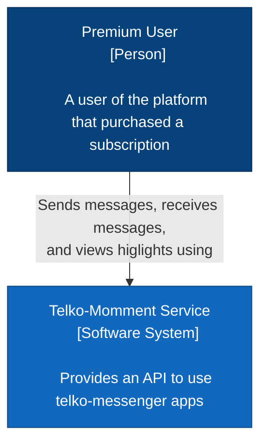

# telko-moment-server 🖥

> - Server to a maui mobile app for android chat-app.
> - The server uses fiber for golang


|   | List of topics                      |
|---|:------------------------------------|
|  | [System Diagrams](#system-diagrams) |
|  | [Miscellaneous](#miscellaneous)     |
| | [Requirements](#requirements) |
| | [Folder Structure](#folder-structure) |


## System Diagrams (C4)


### System Context




## Miscellaneous 

- [<https://gofiber.io/>]
  - [<https://github.com/oapi-codegen/oapi-codegen#impl-fiber>]
  - Open-API-Extensions [<https://github.com/oapi-codegen/oapi-codegen?tab=readme-ov-file#openapi-extensions>]

- [<https://github.com/gofiber/awesome-fiber>]
- [<https://docs.gofiber.io/recipes/>]
- [<https://swagger.io/docs/specification/v3_0/about/>]
  - [<https://medium.com/@fikihalan/a-practical-guide-to-using-oapi-codegen-in-golang-api-development-with-the-fiber-framework-bce2a59380ae>]

---                     
 Tools - [<https://42crunch.com/>]
 OpenAPI Spec - [<https://swagger.io/docs/specification/v3_0/basic-structure/>]
---

- REST APIs [<https://www.ibm.com/think/topics/rest-apis>]
- Api Management [<https://www.ibm.com/think/topics/api-management>]

- JWT
  - Token Claims [<https://datatracker.ietf.org/doc/html/rfc7519#section-4.2>]

- Casbin for ABAC : [<https://casbin.org/>]
  - Golang Repo: [<https://github.com/casbin/casbin>]
  - White paper: [<https://arxiv.org/abs/1903.09756>]
  - ABAC : [<https://casbin.org/docs/abac>]
    - Mongodb Adapter: [<https://github.com/casbin/mongodb-adapter/>]
- ABAC:
  - [<https://frontegg.com/guides/abac>]
  - [<https://learn.microsoft.com/en-us/azure/role-based-access-control/conditions-overview>]
  - 

- Govaluate 
  - Repo : [<https://github.com/Knetic/govaluate>]
---


### Running the App

```shell
oapi-codegen -package=api -generate "types,spec,fiber" oapi_codegen.yml > api/api.gen.go
```

<details>

<summary>

> **[ ORIGINAL/OLD PLAN ]**

</summary>

<h2>About</h2>

> - Server to a flutter android chat-app.
> - The server uses nodejs and frameworks such as ExpressJs, featherJs, stompjs & Prisma ORM.
> - it is split into 2 different servers
>   1. **chat-server** :   for handling chats
>   2. **media-server** :  for handling media files or basically files
> - _*more information on this will be found in the documentation folder_
> - figma links for the designs:
>   1. **auth maps & personas:**   &nbsp;&nbsp; [visit 🔗](https://www.figma.com/file/SBMlL6FtJD69ajJFPGJToU/Telko-moment-%7C-auth-map-%26-User-personas?t=eWpYCmGxitRb2tc7-1)
>   2. **wire frame & prototype**  &nbsp;&nbsp; [visit 🔗](https://www.figma.com/file/ZuSQwcxKaC3hUuFuSnsCqK/Telko-moment-%7C-wireframe-%26-Prototype?t=eWpYCmGxitRb2tc7-1)

## Requirements

> Most of the server requirements are mostly javascript based and a few are other languages but mostly for supporting architecture.
> The requirements are as follows:

1. Nodejs & NPM(Node Package Manager)
2. ExpressJs
3. FeathersJs
4. Stompjs
5. Prisma
6. Databases
    1. Mongodb (server)
    2. SQLite (mobile)
7. RabbitMQ
    - stomp plugin

</details>

## Folder Structure

    /
    ├───design/
    ├───documentation/
    │   ├───mobile/
    │   └───server/
    └───server/
        ├───bin/
        ├───cmd/
        ├───configs/
        ├───internal/
        │   ├───audios/
        │   ├───auth/
        │   ├───messages/
        │   ├───pictures/
        │   ├───users/
        │   └───videos/
        ├───pkg/
        └───test/

---

<br/>

>## `The conventional Go project structure.`

```plaintext
chat-app/
├── cmd/
│   └── server/
│       └── main.go           # Application entry point
├── internal/
│   ├── models/
│   │   ├── message.go        # Message data structures
│   │   └── auth.go          # User data structures
│   ├── controllers/
│   │   ├── auth_controller.go          # Authentication controllers
│   │   ├── message_controller.go       # Message controllers
│   │   └── websocket_controller.go     # WebSocket connection controller
│   ├── handlers/
│   │   ├── auth.go          # Authentication handlers
│   │   ├── message.go       # Message handling
│   │   └── websocket.go     # WebSocket connection handling
│   ├── repository/
│   │   ├── message_repo.go  # Message database operations
│   │   └── user_repo.go     # User database operations
│   └── service/
│       ├── auth_service.go  # Authentication business logic
│       └── chat_service.go  # Chat business logic
├── pkg/
│   ├── websocket/
│   │   └── client.go        # WebSocket client implementation
│   └── utils/
│       └── validator.go     # Common validation utilities
├── configs/
│   └── config.yaml          # Application configuration
├── api/
│   └── routes.go           # API route definitions
├── migrations/
│   └── schema.sql          # Database migrations
├── go.mod                  # Go module file
└── go.sum                  # Go module checksum file

```

Each directory and its purpose:

1. `cmd/`: Contains the main applications of your project
   - This is where your main.go lives
   - Each subdirectory should match the name of the executable you want to build

2. `internal/`: Contains private application code
   - `models/`: Data structures that represent your domain
   - `controllers/`: route controllers
   - `handlers/`: HTTP/WebSocket request handlers
   - `repository/`: Database interaction layer
   - `service/`: Business logic layer

3. `pkg/`: Contains code that's ok to be used by external applications
   - Put reusable components here
   - In your case, websocket handling utilities could go here

4. `configs/`: Configuration files
   - YAML, JSON, or other config files
   - Environment variables templates

5. `api/`: API-related definitions
   - Route setup
   - API documentation
   - OpenAPI/Swagger specs if you use them

6. `migrations/`: Database migration files

This structure follows these key Go principles:

- Separation of concerns
- Clear dependency direction (dependencies flow inward)
- Package-by-feature rather than package-by-layer
- Private application code in `internal/`
- Shared code in `pkg/`

---

### Packages

- fiberi18n: [<https://github.com/gofiber/contrib/tree/main/fiberi18n>]

---

### Use of AI
- AIs have been used in making this app (well; it is 2025 and an extra hand/boost won't hurt) .... although it doesn't control anything or take lead, only for quick questions and some boring but necessary stuff
    - Claude 3.5 & 3.6 (anthropic) 
    - Grok 3 Beta    
    - Gemini (google)

---